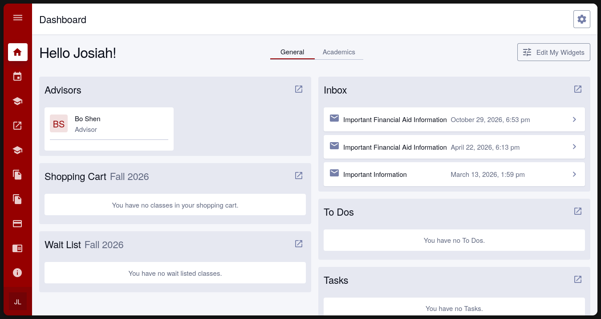
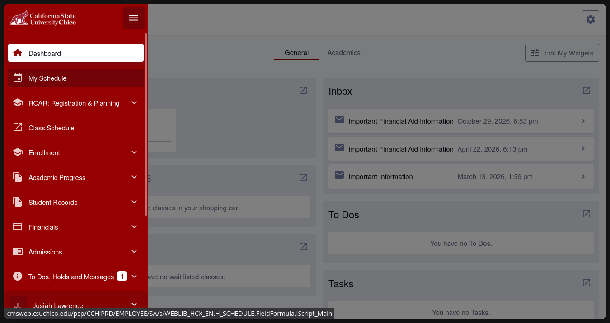
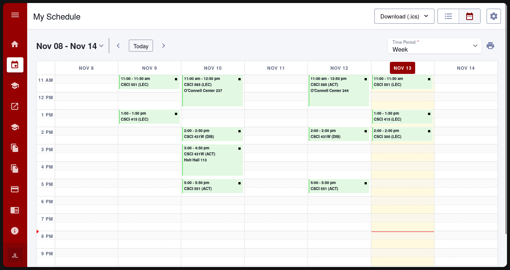
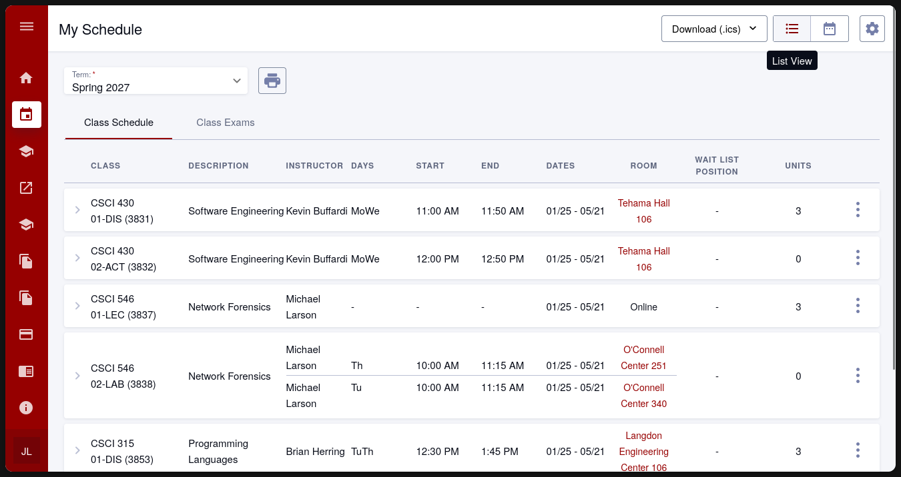
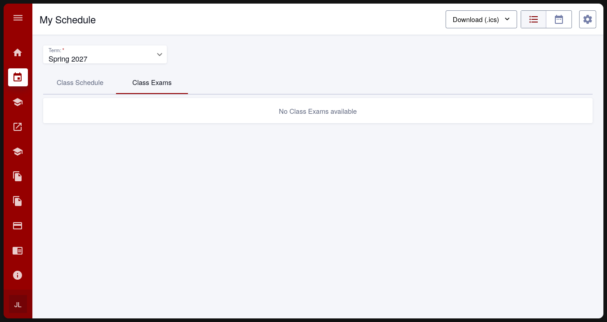
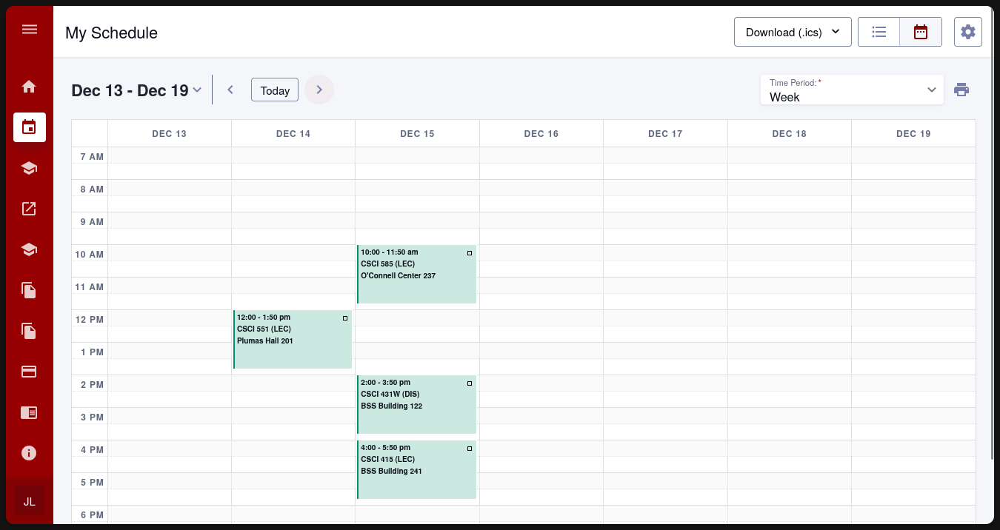
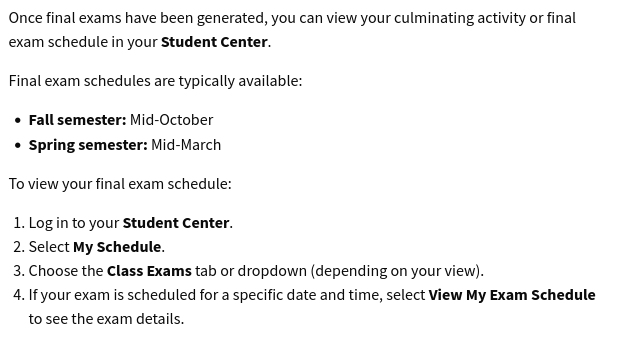
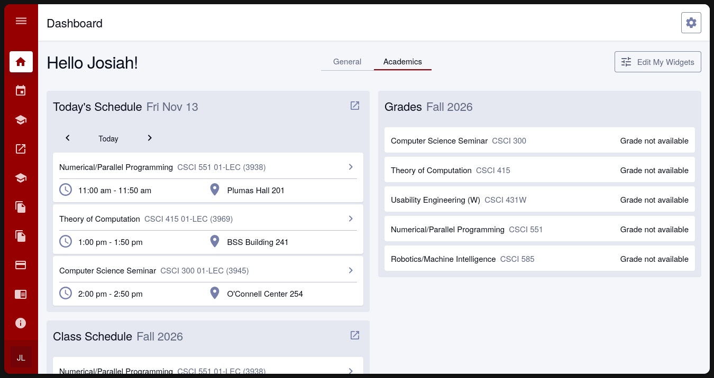
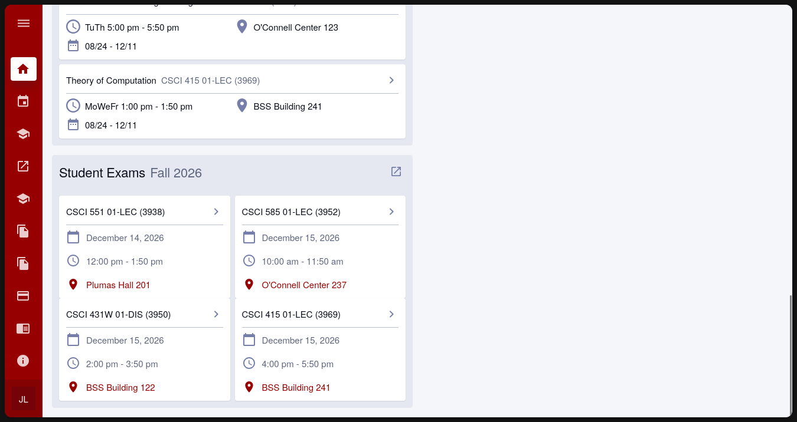

# Finding Final Exams: A Usability Story
If you wanted to know the date and times of your final exams, would you know where to find them? I have a confession. I have been attending California State University, Chico since Fall 2024. In the two years I've been here, I've grown to love the culture, gotten to know many students and faculty, and learned my way around campus by heart. So it is with great shame that I admit that I only discovered the proper way to find my finals schedule... two days ago.

Up until this point, I usually just waited for the final exam times to announced in class. But in my defense, it's not entirely due to laziness on my part! The CSU Chico website has a subtly deceptive usability issue. If I started to get curious about my finals week schedule¸ I would navigate to the Student Center dashboard, where most information about student academics, scheduling, and enrollment is found. 

Now, I am surrounded by a huge amount of information. Luckily for me, the website maintains a logical and orderly **hierarchy of information**... or so I thought! Remember, my goal is to find my final exam schedule, so I open the sidebar and click "My Schedule".

It *seems* a logical choice. I've opened this tab before; it tells me that I have Usability Engineering at 2:00 on Tuesdays and Wednesdays. It shows me that my Parallel Programming class has both a lecture and a lab section. Surely it will offer me the times and dates for my final exams.

Immediately, I see my weekly class schedule. This is not what I'm looking for, so I skim the control buttons at the top of the page. I see the view switcher, and click the button that flips to List View.

To my excitement, there is a tab, next to the Class Schedule, titled Class Exams. *Yes! Now we're getting somewhere,* I think to myself, not unlike a hare wandering into a deadfall trap. I click on Class Exams and...

Nothing. Barren emptiness. Betrayal rises in my chest! I shrug and conclude that maybe the powers that be just haven't decided on the final exam times yet, and give up.

This was not inevitable. As a user, there are certainly other pathways I could have tried at this point, one of which I'll show in this article. However, when I log in to the school website, I have better things to do with my time than dig through the website when I can just ask my professor when the final will be. This is a problem of **cognitive load** -- most users don't want to do a lot of complex thinking to accomplish a simple task.

This also could have been avoided from a design perspective. In fact, this problem highlights an important piece of usability design -- the **affordances** that show your users what a tool does are key to building their **mental model**, that is, their conceptual understanding of how the tool works. I navigated the website in a way that *seemed* correct to me at the time, but turned out to be wrong. When a user's mental model doesn't match reality, the result is confusion and frustration. If users feel lied to by a product, or  feel that their time is being wasted, they *will not want to use the product.* If the tool is non-essential, like a messaging app, they will uninstall it. Worse, if they depend on it for their health or finances, like a hospital answering machine or a banking app, frustration will become anger at being forced to use an unhelpful and confusing tool. 

I later discovered that my failed method of finding my finals schedule is in fact the *recommended* method on the "Culminating Activities and Final Exams" page of the CSU Chico website.

If I had followed the university's own documentation, I still would have ended up with a blank page.

As I mentioned before, I only recently discovered how to find my finals schedule. There are two methods that I have found. First, it is possible to find it from the calendar view of the My Schedules page by clicking forward through each week until it shows the finals week. In retrospect, this does seem pretty natural, although it takes a long time to get to the right week when each page takes a full second to load. Nevertheless, I should have thought of this one a long time ago.

The other method is so hidden, its discovery should be published in an archaeology journal. Remember way back at the beginning, in the student center dashboard? Well, on that page, there's a little tab that says "Academics" that shows a bunch of random stuff collected from other pages.

Way, way down at the very bottom of this page, there is a widget displaying the times, dates, and locations of all my final exams.

Never, if I spent a thousand hours searching, would I have found this if somebody hadn't pointed it out to me. No matter how nifty a widget is, no matter how handy the information it offers, it doesn't make a difference if it's not easily **reachable** by the user. Once you know where this widget is, it's not hard to find, but how would I have ever known where to find it without being explicitly told? Good UX designs use affordances to *show* users how things work without needing to be told.

At the end of the day, this would be a silly thing to get worked up about, and I'm being just a *little* bit dramatic. But I'm telling this story to make a point - even for something as simple as looking up an exam, it's important to consider our designs from the perspective of users. I'm just glad I finally found my exam schedule, and I hope this article helps at least one person find it too!

 
